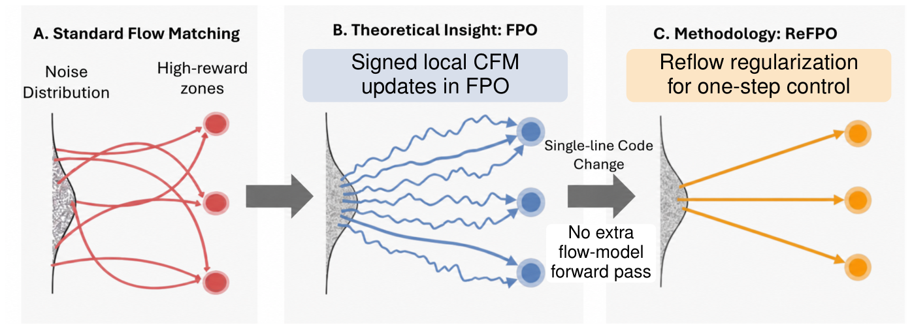

<h1 align="center">ReFPO</h1>
<p align="center"><strong>Reflow Regularization for Flow Matching Policy Gradients</strong></p>

<p align="center">
  Ge Wang, Yibo Peng, Fan Feng, Shenhao Yan, Chengsi Yao, Jiahao Yang, Honghao Cai,<br>
  Yiming Zhao, Xi Li, Jinke Ren, Shuguang Cui, Yatong Han, and Zhen Li
</p>

<p align="center">
  <a href="https://openreview.net/forum?id=QGCmtNLIKF">Paper on OpenReview</a> ·
  <a href="#training-and-evaluation">Training and evaluation</a> ·
  <a href="#citation">BibTeX</a>
</p>

> 🎉 Our paper was accepted for a poster presentation at **NeurIPS 2026**!

<p align="center">
  
</p>

ReFPO adds an advantage-independent flow-matching loss to FPO. It reuses the actions, noise, and times sampled during training, so the regularizer needs no extra model forward pass. At inference, the policy can generate an action in a single Euler step.

## Training and evaluation

Each benchmark has its own environment. Follow the setup and commands in the corresponding directory.

| Benchmark | Implementation | Evaluation |
| --- | --- | --- |
| [GridWorld](gridworld/README.md) | PyTorch, CPU or CUDA | Goal-reaching success rate and episode return |
| [MuJoCo Playground](playground/README.md) | JAX | Paired 10-step and 1-step returns from one checkpoint, with a script to aggregate the ten-task table |
| [Humanoid tracking](phc/README.md) | PyTorch and Isaac Gym on Linux | Motion completion rate, alive duration in steps, and global joint position error in mm |

## Acknowledgments

We thank David McAllister, Songwei Ge, Brent Yi, Chung Min Kim, Ethan Weber, Hongsuk Choi, Haiwen Feng, and Angjoo Kanazawa for releasing **Flow Matching Policy Gradients**. We adapted their training code and benchmark implementations for ReFPO. [FPO paper](https://arxiv.org/abs/2507.21053) · [FPO code](https://github.com/akanazawa/fpo)

The GridWorld trainer builds on Eric Yang Yu's PPO implementation. The continuous control experiments use MuJoCo Playground and Brax. Our humanoid implementation extends FPO's adaptation of Kyoung Whan Choe's Puffer PHC, which builds on Perpetual Humanoid Control and PufferLib. We thank the authors of these projects for making their implementations available. [PPO for Beginners](https://github.com/ericyangyu/PPO-for-Beginners) · [MuJoCo Playground](https://github.com/google-deepmind/mujoco_playground) · [Brax](https://github.com/google/brax) · [Puffer PHC](https://github.com/kywch/puffer-phc) · [PHC](https://github.com/ZhengyiLuo/PHC) · [PufferLib](https://github.com/PufferAI/PufferLib)

## Citation

```bibtex
@inproceedings{wang2026refpo,
  title     = {{ReFPO}: Reflow Regularization for Flow Matching Policy Gradients},
  author    = {Wang, Ge and Peng, Yibo and Feng, Fan and Yan, Shenhao and
               Yao, Chengsi and Yang, Jiahao and Cai, Honghao and Zhao, Yiming and
               Li, Xi and Ren, Jinke and Cui, Shuguang and Han, Yatong and Li, Zhen},
  booktitle = {Advances in Neural Information Processing Systems},
  year      = {2026},
  url       = {https://openreview.net/forum?id=QGCmtNLIKF}
}
```

## Licenses

Original ReFPO contributions are available under the [MIT License](LICENSE). The distributed GridWorld and Playground code retains its [GridWorld MIT notices](gridworld/LICENSE) and [Playground Apache 2.0 license](playground/LICENSE), respectively. The humanoid directory provides our changes against a pinned upstream revision. Isaac Gym, AMASS, and SMPL are obtained separately under their providers' terms. [Humanoid setup](phc/README.md)
